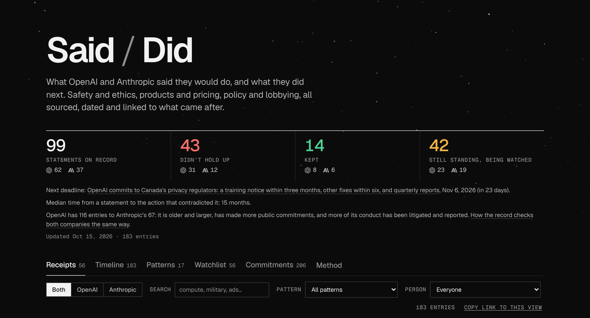

# Said / Did

[](https://alemiscate.github.io/accountability/)

**[alemiscate.github.io/accountability](https://alemiscate.github.io/accountability/)**

A sourced public record of what OpenAI and Anthropic, and the people who lead
them, said they would do, set against what they did next. It covers safety,
ethics and military use as well as products, pricing and lobbying. Kept
promises are recorded too.

When an action contradicts an earlier statement, the two are linked into a
**receipt** showing how much time passed between them. Every quote is verbatim
from a source read in full, and every source is saved so it can be checked
after it changes or disappears.

On the site:

- **Receipts**: statements next to the actions that contradicted them.
- **Timeline**: everything, in date order.
- **Patterns**: behavior that keeps recurring, and what to watch for next.
- **Watchlist**: promises still standing, each with a test for what would break it.
- **Commitments**: every pledge in the documents each company signed, graded one by one.
- **Fine print**: every change found in the archived history of both companies' policy, terms, pricing and help pages, and whether it was announced.
- **Method**: how the record is kept, and who writes it.

There is also a [plain, script-free version](https://alemiscate.github.io/accountability/record.html),
an [Atom feed](https://alemiscate.github.io/accountability/feed.xml), and the
whole record as [JSON](https://alemiscate.github.io/accountability/said-did.json)
or [CSV](https://alemiscate.github.io/accountability/entries.csv).

## Run it locally

```sh
npm install
npm run build    # check the record and build the site
npm run serve    # http://localhost:4173
```

## Learn more

- [METHODOLOGY.md](METHODOLOGY.md): what counts as evidence, how statuses are assigned, how corrections work, and who writes the record.
- [COVERAGE.md](COVERAGE.md): where the entries came from, how the two companies compare, and what may still be missing.
- [CONTRIBUTING.md](CONTRIBUTING.md): adding entries, saving sources, finding posts, watching pages for edits, and the automated jobs.

Every entry is a plain YAML file in `data/entries/`. Corrections are welcome as
issues or pull requests.

## License

The record is licensed under [CC BY 4.0](LICENSE). Anyone may copy, share and
adapt it, including commercially, as long as they credit Said / Did, link to
the site, and say if they changed it. That covers the entries and the other
files in `data/`, the written documents (METHODOLOGY.md, COVERAGE.md and the
notes in `inbox/` and `reports/`), and the downloads the site publishes.
A credit line can be as short as: Said / Did,
https://alemiscate.github.io/accountability/, CC BY 4.0.

The code (`scripts/`, `tests/`, the workflows, and the site's HTML, CSS and
JavaScript) is under the [MIT License](LICENSE-CODE). The fonts in
`site/fonts/` keep their own license (`OFL.txt`).

Neither license covers what others wrote or own: the statements quoted in
entries, the copies of pages and posts kept as evidence (the page texts in
`snapshots/`, `watch/` and `inbox/history/`, the posts collected in
`inbox/sweep/`, and the archive repository), and the OpenAI and Anthropic
logos. Those belong to their owners and are kept so the sources can be
checked.
